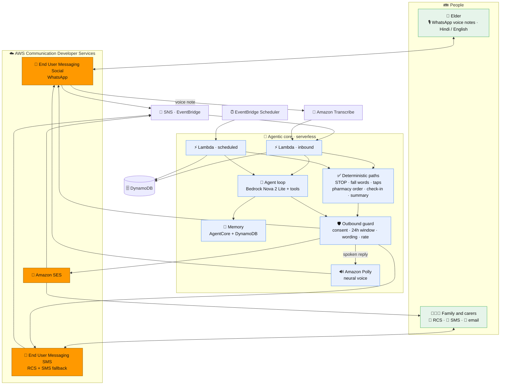

<p align="center">
  
</p>

<h1 align="center">AuraSenior</h1>

<p align="center">
  <b>A voice-first companion that lives inside WhatsApp for older adults</b><br/>
  It checks in every morning, understands voice replies in Hindi and English, and keeps family and care
  contacts informed on RCS, SMS and email — built end to end on AWS Communication Developer Services.
</p>

<p align="center">
  
  
  
  
  
</p>

> It only acts on someone's behalf — a refill order, an alert — after a person approves or the elder asks for help.
>
> **Not a medical device.** It never diagnoses, names an illness, changes doses or gives a health score. A voice
> "change from usual" signal only ever leads to a fixed "worth a call" suggestion to family.

---

## 🎯 FOR JUDGES: How to Test AuraSenior

**AuraSenior has no web frontend** — it's a WhatsApp/RCS/SMS/email messaging system. You have three ways to evaluate it:

### Option 1: Watch the 3-minute demo video (fastest)
**Video:** [https://vimeo.com/1239435867](https://vimeo.com/1239435867)

Shows the complete live flow: WhatsApp Hindi voice interaction, RCS interactive card with tap buttons, pharmacy order via SES, and safety features — all running on the deployed AWS stack.

### Option 2: Run the offline demo scenario (5 minutes, no AWS account)
See the entire workflow locally with channels and model stubbed (clearly labeled `[SIMULATED]`):

```bash
git clone https://github.com/Extraordinarytechy/aurasenior.git
cd aurasenior
python -m venv .venv && .venv/bin/pip install -r requirements-dev.txt
PYTHONPATH=src .venv/bin/python -m aurasenior.demo replay
```

This runs: opt-in, morning check-in, Hindi and English voice replies, refill approval card, pharmacy order, missed check-in alert, fall detection, weekly summary, and STOP — the full story in your terminal.

### Option 3: Request live access (WhatsApp/RCS testing)
Live channels require consent and test device registration (WhatsApp Business API + RCS testing agent rules). 

**For judges:** Email **founder@fanzra.com** with subject "AuraSenior Hackathon Judge Access" and include:
- Your WhatsApp number (for elder-side voice testing)
- Your RCS-enabled phone number (for family-side interactive card testing)
- Your email address (for weekly summary and pharmacy order testing)

We'll add you to the opt-in list and test device registry within 24 hours. Once approved, you'll receive:
- WhatsApp opt-in confirmation message
- RCS test device verification (via RBM Tester Management)
- Sample household credentials for testing

**Test contact:** For immediate questions, WhatsApp or email founder@fanzra.com

**Evidence of live deployment:** See `docs/evidence/` for redacted AWS console screenshots, DynamoDB traces, and SES delivery confirmations showing the system running on `us-east-1`.

---

The product name is one config value: `[brand] name` in `src/config/app.toml`.

## ✨ Highlights

- 🎙️ **Voice-first** — older adults just send WhatsApp voice notes. No app, no typing, in their own language.
- 🔀 **True omnichannel** — a conversation starts on WhatsApp 💬, completes an action on RCS 📲 (tap to approve a
  refill), and lands as a weekly summary on email 📧.
- 🛡️ **Safety by construction** — STOP, fall words, approval taps and the pharmacy order are deterministic code,
  never the model. Every send crosses one guard: consent, the WhatsApp 24-hour window, a wording rule and a rate cap.
- 🧠 **Remembers** — per-elder long-term memory on Amazon Bedrock AgentCore, with a DynamoDB fallback.
- ☁️ **Serverless on AWS CDS** — events in through SNS/EventBridge, Lambda, Bedrock, Transcribe, Polly and SES.
  No public HTTP endpoint.

## Try it (no AWS account needed)

AuraSenior has no web front end — it lives in WhatsApp, RCS, SMS and email. The fastest way to see the whole
workflow is the bundled offline scenario: it runs the full story (opt-in, morning check-in, a Hindi and an
English voice reply, the refill card and tap, the pharmacy order, a missed check-in, a fall alert, the weekly
summary and STOP) with the channels, Transcribe, Scheduler and the model stubbed locally and labelled
`[SIMULATED]` — **no AWS account or credentials required**:

```bash
python -m venv .venv && .venv/bin/pip install -r requirements-dev.txt
.venv/bin/python -m pytest -q                         # full suite, fully mocked (no AWS)
PYTHONPATH=src .venv/bin/python -m aurasenior.demo replay
```

To exercise the **live deployed** agent, the channels are consent- and test-device gated (RCS testing agents
deliver only to pre-registered devices, WhatsApp requires an opt-in), so access is granted on request: email
<founder@fanzra.com> to be added as a WhatsApp opt-in or an RCS test device. The ~3-minute demo video shows the
end-to-end flow on real devices, and **Deploy** below has full self-host steps.

## How it works



- Every inbound event arrives through SNS or EventBridge. There is no public HTTP endpoint.
- Channel choice is data: each person has `language`, `preferred_channel` and `fallback_channel`. The agent asks to
  message a person; the router picks the channel and falls back on failure.
- Safety-critical steps never depend on the model: STOP, fall and help words, approval and acknowledgement taps,
  the pharmacy order, the check-in chain and the weekly summary are plain code.
- Every send crosses one outbound guard: consent on that channel, the WhatsApp 24-hour window (templates outside
  it), a wording rule in Hindi and English, and an hourly cap for normal messages.
- Each step is written to a trace that the trace view prints, with any simulated parts clearly labelled.

## Repository layout

```text
src/aurasenior/        Python package (both Lambda functions)
  handlers/            inbound and scheduled entry points
  channels/            WhatsApp, RCS, SMS and email adapters plus local simulators
  agent/               Converse tool-use loop, tools, prompt
  memory/              MemoryStore: AgentCore Memory with DynamoDB fallback
  sim/                 local stand-ins for Scheduler, Transcribe and a scripted model
src/config/            app settings, language rows, phrases, WhatsApp templates, keyword and wording lists
households/            sample household files (fictional data)
scripts/               seed_household.py, post_deploy.py, check_permissions.py
template.yaml          AWS SAM template (stack aurasenior)
site/                  public pages (home, privacy policy, terms) and brand images, with their own stack template
tests/                 unit tests, the sample household scenario, and live tests (opt-in)
```

## Run the tests and the offline scenario

Python 3.13.

```bash
python -m venv .venv && .venv/bin/pip install -r requirements-dev.txt
.venv/bin/python -m pytest -q
PYTHONPATH=src .venv/bin/python -m aurasenior.demo replay
```

`demo replay` runs the sample household story fully offline: opt-in, the 9 AM check-in template and Listen tap, a
Hindi and an English voice reply, the refill card and Order refill tap, the pharmacy email, the confirmation voice
note, a missed check-in, a fall alert and acknowledgement, "How was Mom this week?", the Sunday summary and STOP.
This offline harness swaps the channels, Transcribe and Scheduler for local simulators, DynamoDB and S3 for
in-memory mocks, and the model for a scripted stand-in replaying recorded responses, so it needs no AWS account.
The trace labels these `[SIMULATED]` and `[SCRIPTED MODEL]`. The channel simulators report each message as
delivered right after the send. One case is scripted as not delivered: the son's RCS fall alert, so the delivery
check sends the SMS fallback and he replies 4 by SMS.

## ✅ What runs live on AWS

Deployed to `us-east-1` (stack `aurasenior`), with redacted evidence under [`docs/evidence/`](docs/evidence):

- **WhatsApp** — AWS End User Messaging Social. The elder sends a voice note; Amazon Transcribe turns it into text,
  the agent answers, and a spoken reply from Amazon Polly (neural voice) is delivered back on WhatsApp. Verified
  end to end with a live Hindi voice round-trip.
- **RCS** — AWS End User Messaging SMS. A verified test device received the opt-in, the "Mom's BP tablets ran out"
  refill card, and — after tapping **Order refill** — the order confirmation. The deployed Lambda sends with
  `SendRcsMessage`. Testing agents deliver only to registered test devices in
  [supported countries](https://docs.aws.amazon.com/sms-voice/latest/userguide/rcs-supported-countries.html); a
  device in Canada was used, since India is not yet on that list.
- **Email** — Amazon SES: the weekly family and doctor summary, and the pharmacy order email after an approval tap,
  with SES delivery events back through SNS.
- **Agent** — Amazon Nova 2 Lite through the Bedrock Converse API with tool use, including a Hindi turn that logged
  a medicine and a health question answered with the fixed "please ask your doctor" line.
- **Memory** — Amazon Bedrock AgentCore Memory: the elder's turns are written as memory events, and the live test
  retrieved an extracted fact.
- **Guardrail** — a Bedrock guardrail runs on every turn with its topics in detect-only mode and its findings in
  the trace; the no-diagnosis and no-dose rule is enforced by the system prompt and the deterministic wording rule.
- **Ops** — an ERROR log line raised the CloudWatch alarm and its email arrived; the public privacy and terms pages
  serve from their own CloudFront stack.

### Still to provision (external onboarding, not code)

- **SMS** uses the AWS simulator origination number, which only reaches AWS's simulator destination numbers. A
  production 10DLC or toll-free number is the one step left for real SMS — and for the RCS → SMS fallback to reach
  real phones.
- **Wider RCS delivery** needs the RCS agent launched with Google and the carriers; until then it delivers to
  registered test devices only, which is the standard delivery model during RCS limited availability.

## Deploy

Prerequisites: AWS SAM CLI, Python 3.13, an AWS account and region `us-east-1`.

```bash
sam build
sam deploy --stack-name aurasenior --region us-east-1 --tags project=aurasenior --resolve-s3 \
  --capabilities CAPABILITY_NAMED_IAM \
  --parameter-overrides AlertEmail=<you@example.com> SenderEmail=<sender@example.com> \
    WhatsAppPhoneNumberId=<phone-number-id-...> RcsAgentId=<rcs-...>
python scripts/seed_household.py households/<your-household>.toml
python scripts/post_deploy.py --household households/<your-household>.toml
```

Leave `RcsAgentId` and `WhatsAppPhoneNumberId` empty to keep RCS and WhatsApp on the local simulator adapters while
you set up the channels; email, the model, memory, Transcribe, Polly, Scheduler and the alarm run on AWS either way.

Steps that need a person:

1. SES: create and verify an email identity for `SenderEmail` and for each email recipient (the account starts in
   the SES sandbox). `post_deploy.py` lists any identity that is not verified yet. Confirm the SNS subscription
   email sent to `AlertEmail`.
2. Email consent: `python -m aurasenior.admin consent <household_id> <person_id> email opted_in --source "<how>"`.
3. RCS: create an RCS agent with a testing registration in the console (logo, banner, colour, and the privacy and
   terms URLs from the public pages below). Add each family phone as a test device:
   `aws pinpoint-sms-voice-v2 create-verified-destination-number --destination-phone-number <E.164> --rcs-agent-id <id>`.
   The phone gets an invitation from "RBM Tester Management" within about 20 minutes; the device is ready when
   `describe-verified-destination-numbers` shows `VERIFIED`. Then redeploy with `RcsAgentId=<id>`, run
   `post_deploy.py` (turns on two-way messaging to the stack's SNS topic and sets the opt-out list), and ask for
   opt-in with `python -m aurasenior.admin rcs-ask <household_id> <person_id>`. The person replies YES.
4. WhatsApp: link a WhatsApp Business Account in AWS End User Messaging Social, with event publishing to the SNS
   topic `aurasenior-whatsapp-events`. Redeploy with `WhatsAppPhoneNumberId=phone-number-id-...`, then run
   `post_deploy.py --waba-id waba-...` to set the event destination and submit the 14 templates (7 in Hindi and 7
   in English) for review. The elder sends START to the business number to begin opt-in.

Trace view: `python -m aurasenior.trace <household_id> --since 2h`.

### Public pages

The privacy policy and terms that the RCS registration needs are static pages on a private S3 bucket behind
CloudFront, in a separate stack:

```bash
aws cloudformation deploy --stack-name aurasenior-site --template-file site/template.yaml \
  --tags project=aurasenior --region us-east-1
```

Upload `site/index.html`, `site/privacy.html` and `site/terms.html` (with `{{CONTACT_EMAIL}}` replaced),
`site/style.css` and the two images in `site/brand/` to the root of the `SiteBucketName` output. The pages are
served at the `SiteUrl` output.

## Households and languages

A household is one TOML file. `households/sample.toml` is an India-based elder with a son in the US;
`households/sample-us.toml` is a US-only household that runs on the same code with no changes. Hindi and English
are built and tested. A new language is one row in `[languages]` plus phrase rows and a test.

## Costs and limits

Serverless and pay per use: idle cost is close to zero (DynamoDB on demand, Lambda, SNS, two schedules per
household, a CloudFront distribution with price class 100 for the public pages). The main variable costs are model
calls, messages and voice notes: the agent is capped at 150 model calls per household per day, and normal messages
at 30 per household per hour (urgent alerts are never capped). RCS test messages are charged at standard RCS rates.
The stack includes a monthly budget of USD 25 that emails `AlertEmail` at 80% of actual spend. SES sandbox:
verified recipients only, 200 messages a day.

## License

Released under the MIT License. See [LICENSE](LICENSE).
