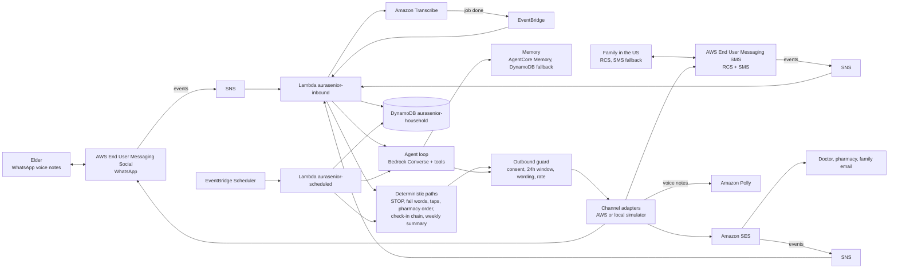

# AuraSenior

A companion that lives inside WhatsApp for older people who send voice notes and will not install an app. It checks
in each morning, understands voice replies in Hindi and English, and keeps family and care contacts informed on RCS,
SMS and email. It only acts on someone's behalf (a refill order, an alert) after a person approves or the elder asks
for help.

Not a medical device. It never diagnoses, names an illness, changes doses or gives a health score. Voice "change
from usual" signals only ever lead to a fixed "worth a call" suggestion to family.

The product name is one config value: `[brand] name` in `src/config/app.toml`.

## How it works



- Every inbound event arrives through SNS or EventBridge. There is no public HTTP endpoint.
- Channel choice is data: each person has `language`, `preferred_channel` and `fallback_channel`. The agent asks to
  message a person; the router picks the channel and falls back on failure.
- Safety-critical steps never depend on the model: STOP, fall and help words, approval and acknowledgement taps,
  the pharmacy order, the check-in chain and the weekly summary are plain code.
- Every send crosses one outbound guard: consent on that channel, the WhatsApp 24-hour window (templates outside
  it), a wording rule in Hindi and English, and an hourly cap for normal messages.
- Each step is written to a trace that the local trace view prints, with simulated parts labelled.

## Repository layout

```text
src/aurasenior/        Python package (both Lambda functions)
  handlers/            inbound and scheduled entry points
  channels/            WhatsApp, RCS, SMS and email adapters plus local simulators
  agent/               Converse tool-use loop, tools, prompt
  memory/              MemoryStore: AgentCore Memory with DynamoDB fallback
  sim/                 local stand-ins for Scheduler, Transcribe and a scripted model
src/config/            app settings, language rows, phrases, WhatsApp templates, keyword and wording lists
households/            sample household files (fictional data)
scripts/               seed_household.py, post_deploy.py, check_permissions.py
template.yaml          AWS SAM template (stack aurasenior)
tests/                 unit tests, the sample household scenario, and live tests (opt-in)
```

## Run the tests and the offline scenario

Python 3.13.

```bash
python -m venv .venv && .venv/bin/pip install -r requirements-dev.txt
.venv/bin/python -m pytest -q
PYTHONPATH=src .venv/bin/python -m aurasenior.demo replay
```

`demo replay` runs the sample household story fully offline: opt-in, the 9 AM check-in template and Listen tap, a
Hindi and an English voice reply, the refill card and Order refill tap, the pharmacy email, the confirmation voice
note, a missed check-in, a fall alert and acknowledgement, "How was Mom this week?", the Sunday summary and STOP.
Channels, Transcribe and Scheduler are local simulators, DynamoDB and S3 are in-memory mocks, and the model is a
scripted stand-in replaying recorded responses. The trace labels these `[SIMULATED]` and `[SCRIPTED MODEL]`.

## Deploy

Prerequisites: AWS SAM CLI, Python 3.13, an AWS account and region `us-east-1`.

```bash
sam build
sam deploy --stack-name aurasenior --region us-east-1 --tags project=aurasenior --resolve-s3 \
  --capabilities CAPABILITY_NAMED_IAM \
  --parameter-overrides AlertEmail=<you@example.com> SenderEmail=<sender@example.com>
python scripts/seed_household.py households/<your-household>.toml
python scripts/post_deploy.py --household households/<your-household>.toml
```

Console steps that need a person:

1. SES: create and verify an email identity for `SenderEmail` and for each email recipient (the account starts in
   the SES sandbox). `post_deploy.py` lists any identity that is not verified yet.
2. RCS: create an RCS testing agent and add each family phone as a test device (a code is sent to the phone), then
   redeploy with `RcsAgentId=<id>` and run `post_deploy.py`. Ask for opt-in with
   `python -m aurasenior.admin rcs-ask <household_id> <person_id>`.
3. WhatsApp: link a WhatsApp Business Account in AWS End User Messaging Social, redeploy with
   `WhatsAppPhoneNumberId=<id>`, then run `post_deploy.py --waba-id <id>` to set the event destination and submit
   the templates for review.
4. Email consent: `python -m aurasenior.admin consent <household_id> <person_id> email opted_in --source "<how>"`.

Trace view: `python -m aurasenior.trace <household_id> --since 2h`.

## Households and languages

A household is one TOML file. `households/sample.toml` is an India-based elder with a son in the US;
`households/sample-us.toml` is a US-only household that runs on the same code with no changes. Hindi and English
are built and tested. A new language is one row in `[languages]` plus phrase rows and a test.

## What is simulated today

- WhatsApp, RCS and SMS run on local simulators until the WhatsApp Business Account and the RCS test agent are
  linked. SMS uses the AWS simulator origination number, which only reaches simulator destination numbers.
- The SMS simulator family record in the sample household is simulated and labelled so.
- The offline scenario uses a scripted model. `tests/live/` (run with `AURASENIOR_LIVE=1`) makes a real Bedrock
  Converse tool-use call and a real AgentCore Memory round trip (create a temporary memory, write Hindi turns,
  retrieve an extracted fact, delete it); results are in `docs/evidence/`. The stack itself has not been deployed
  yet.

## Costs and limits

Serverless and pay per use: idle cost is close to zero. The agent is capped at 150 model calls per household per day
and normal messages at 30 per household per hour (urgent alerts are never capped). A monthly AWS budget alert is
part of the stack. SES sandbox: verified recipients only, 200 messages a day.
