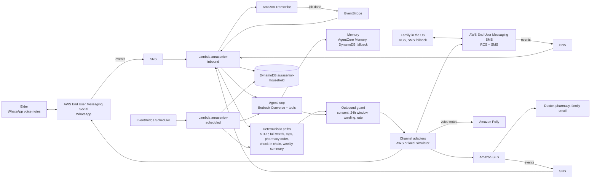

# AuraSenior

A companion that lives inside WhatsApp for older people who send voice notes and will not install an app. It checks
in each morning, understands voice replies in Hindi and English, and keeps family and care contacts informed on RCS,
SMS and email. It only acts on someone's behalf (a refill order, an alert) after a person approves or the elder asks
for help.

Not a medical device. It never diagnoses, names an illness, changes doses or gives a health score. Voice "change
from usual" signals only ever lead to a fixed "worth a call" suggestion to family.

The product name is one config value: `[brand] name` in `src/config/app.toml`.

## How it works



- Every inbound event arrives through SNS or EventBridge. There is no public HTTP endpoint.
- Channel choice is data: each person has `language`, `preferred_channel` and `fallback_channel`. The agent asks to
  message a person; the router picks the channel and falls back on failure.
- Safety-critical steps never depend on the model: STOP, fall and help words, approval and acknowledgement taps,
  the pharmacy order, the check-in chain and the weekly summary are plain code.
- Every send crosses one outbound guard: consent on that channel, the WhatsApp 24-hour window (templates outside
  it), a wording rule in Hindi and English, and an hourly cap for normal messages.
- Each step is written to a trace that the local trace view prints, with simulated parts labelled.

## Repository layout

```text
src/aurasenior/        Python package (both Lambda functions)
  handlers/            inbound and scheduled entry points
  channels/            WhatsApp, RCS, SMS and email adapters plus local simulators
  agent/               Converse tool-use loop, tools, prompt
  memory/              MemoryStore: AgentCore Memory with DynamoDB fallback
  sim/                 local stand-ins for Scheduler, Transcribe and a scripted model
src/config/            app settings, language rows, phrases, WhatsApp templates, keyword and wording lists
households/            sample household files (fictional data)
scripts/               seed_household.py, post_deploy.py, check_permissions.py
template.yaml          AWS SAM template (stack aurasenior)
site/                  public pages (home, privacy policy, terms) and brand images, with their own stack template
tests/                 unit tests, the sample household scenario, and live tests (opt-in)
```

## Run the tests and the offline scenario

Python 3.13.

```bash
python -m venv .venv && .venv/bin/pip install -r requirements-dev.txt
.venv/bin/python -m pytest -q
PYTHONPATH=src .venv/bin/python -m aurasenior.demo replay
```

`demo replay` runs the sample household story fully offline: opt-in, the 9 AM check-in template and Listen tap, a
Hindi and an English voice reply, the refill card and Order refill tap, the pharmacy email, the confirmation voice
note, a missed check-in, a fall alert and acknowledgement, "How was Mom this week?", the Sunday summary and STOP.
Channels, Transcribe and Scheduler are local simulators, DynamoDB and S3 are in-memory mocks, and the model is a
scripted stand-in replaying recorded responses. The trace labels these `[SIMULATED]` and `[SCRIPTED MODEL]`.
The channel simulators report each message as delivered right after the send. One case is scripted as not
delivered: the son's RCS fall alert, so the delivery check sends the SMS fallback and he replies 4 by SMS.

## Deploy

Prerequisites: AWS SAM CLI, Python 3.13, an AWS account and region `us-east-1`.

```bash
sam build
sam deploy --stack-name aurasenior --region us-east-1 --tags project=aurasenior --resolve-s3 \
  --capabilities CAPABILITY_NAMED_IAM \
  --parameter-overrides AlertEmail=<you@example.com> SenderEmail=<sender@example.com>
python scripts/seed_household.py households/<your-household>.toml
python scripts/post_deploy.py --household households/<your-household>.toml
```

With no `RcsAgentId` and no `WhatsAppPhoneNumberId`, RCS and WhatsApp stay on the simulator adapters. Email, the
model, memory, Transcribe, Polly, Scheduler and the alarm run on AWS.

Steps that need a person:

1. SES: create and verify an email identity for `SenderEmail` and for each email recipient (the account starts in
   the SES sandbox). `post_deploy.py` lists any identity that is not verified yet. Confirm the SNS subscription
   email sent to `AlertEmail`.
2. Email consent: `python -m aurasenior.admin consent <household_id> <person_id> email opted_in --source "<how>"`.
3. RCS: create an RCS agent with a testing registration in the console (logo, banner, colour, and the privacy and
   terms URLs from the public pages below). Add each family phone as a test device:
   `aws pinpoint-sms-voice-v2 create-verified-destination-number --destination-phone-number <E.164> --rcs-agent-id <id>`.
   The phone gets an invitation from "RBM Tester Management" within about 20 minutes; the device is ready when
   `describe-verified-destination-numbers` shows `VERIFIED`. Then redeploy with `RcsAgentId=<id>`, run
   `post_deploy.py` (turns on two-way messaging to the stack's SNS topic and sets the opt-out list), and ask for
   opt-in with `python -m aurasenior.admin rcs-ask <household_id> <person_id>`. The person replies YES.
4. WhatsApp: link a WhatsApp Business Account in AWS End User Messaging Social, with event publishing to the SNS
   topic `aurasenior-whatsapp-events`. Redeploy with `WhatsAppPhoneNumberId=phone-number-id-...`, then run
   `post_deploy.py --waba-id waba-...` to set the event destination and submit the 14 templates (7 in Hindi and 7
   in English) for review. The elder sends START to the business number to begin opt-in.

Trace view: `python -m aurasenior.trace <household_id> --since 2h`.

### Public pages

The privacy policy and terms that the RCS registration needs are static pages on a private S3 bucket behind
CloudFront, in a separate stack:

```bash
aws cloudformation deploy --stack-name aurasenior-site --template-file site/template.yaml \
  --tags project=aurasenior --region us-east-1
```

Upload `site/index.html`, `site/privacy.html` and `site/terms.html` (with `{{CONTACT_EMAIL}}` replaced),
`site/style.css` and the two images in `site/brand/` to the root of the `SiteBucketName` output. The pages are
served at the `SiteUrl` output.

## Households and languages

A household is one TOML file. `households/sample.toml` is an India-based elder with a son in the US;
`households/sample-us.toml` is a US-only household that runs on the same code with no changes. Hindi and English
are built and tested. A new language is one row in `[languages]` plus phrase rows and a test.

## What is real and what is simulated today

Real, on the deployed stack in `us-east-1` (redacted runs in `docs/evidence/live-2026-10-12-*`):

- Email through Amazon SES: the weekly summary delivered to the family and doctor addresses, and the pharmacy
  order email sent after an approval tap, with SES delivery events back through SNS.
- Agent turns on Amazon Nova 2 Lite through the Bedrock Converse API with tool use, including a Hindi turn that
  logged a medicine and a health question answered with the fixed "please ask your doctor" line.
- Amazon Bedrock AgentCore Memory: the elder's turns are written as memory events. The live test round trip in
  `tests/live/` also retrieved an extracted fact.
- The Bedrock guardrail runs on every turn with its topics in detect-only mode, and its findings are kept in the
  trace. The no-diagnosis and no-dose rule is enforced by the system prompt and by the outbound wording rule.
- The error alarm: an ERROR log line raised the alarm and its email arrived.
- The public pages stack (`site/template.yaml`).

Still simulated, and why:

- WhatsApp: the WhatsApp Business Account is not linked yet, so the elder's messages are injected as simulated
  inbound events and her replies go to the simulator. The trace marks them `[SIMULATED]`.
- RCS: the RCS testing agent is approved and active, but a testing agent only delivers to registered test devices.
  The test number available, an Indian mobile, was refused as a test device with `COUNTRY_NOT_ENABLED`: India is
  not one of the 22 countries in
  [Supported countries for RCS](https://docs.aws.amazon.com/sms-voice/latest/userguide/rcs-supported-countries.html).
  Until a test device in a supported country is verified, the son's RCS messages go to the simulator. The RCS
  requests are checked against the SDK model in the tests.
- SMS uses the AWS simulator origination number, which only reaches simulator destination numbers. The simulator
  family record in the sample household is labelled simulated.
- Transcribe and Polly run only on the WhatsApp voice path, so they wait for WhatsApp too.
- The offline scenario (`demo replay`) uses a scripted model. `tests/live/` (run with `AURASENIOR_LIVE=1`) makes
  a real Bedrock Converse tool-use call and a real AgentCore Memory round trip.

## Costs and limits

Serverless and pay per use: idle cost is close to zero (DynamoDB on demand, Lambda, SNS, two schedules per
household, a CloudFront distribution with price class 100 for the public pages). The main variable costs are model
calls, messages and voice notes: the agent is capped at 150 model calls per household per day, and normal messages
at 30 per household per hour (urgent alerts are never capped). RCS test messages are charged at standard RCS rates.
The stack includes a monthly budget of USD 25 that emails `AlertEmail` at 80% of actual spend. SES sandbox:
verified recipients only, 200 messages a day.

## License

Released under the MIT License. See [LICENSE](LICENSE).
