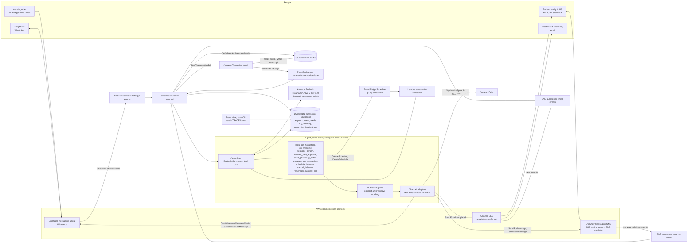

# Design

Status: Milestone 1 design, first full version (2026-10-10). Every AWS API, parameter, resource type, model ID and
limit named here is backed by an entry in `docs/decisions.md` (official doc URL or a real read-only call saved in
`docs/evidence/`). Anything not yet confirmed is listed as an open assumption in section 17 and in `decisions.md`
D13, and must be resolved before the code that depends on it is called done.

## 1. Overview

AuraSenior is a companion that lives inside WhatsApp for older people who send voice notes and will not install an
app. It checks in each morning, understands voice replies in Hindi and English, keeps family and care team informed
on RCS, SMS and email, and only acts on her behalf (refills, alerts) after a person approves.

It is not a medical device. It never diagnoses, names a disease, changes doses or gives a health score.

It is built for families split across countries, and the country logic is data, not code. Each person in a
household has `country`, `language`, `preferred_channel` and `fallback_channel`. The agent sends on the preferred
channel and uses the fallback when a send fails or, for urgent messages, is not delivered in time. There is no
country routing engine.

Demo household: Kamala (78, Pune, India, Hindi, WhatsApp voice), her son Rohan (Seattle, US, English, RCS with SMS
fallback), a neighbour (India, WhatsApp), and her doctor and pharmacy (email). The README also shows a config-only
US household (English-speaking elder in Ohio, daughter on RCS) that uses the same code.

Default channel per person type (a convention for household setup, not code):

| Person | preferred_channel | fallback_channel | Why |
| --- | --- | --- | --- |
| Elder (any country) | whatsapp | none | WhatsApp voice works in every country the demo needs |
| Family in the US | rcs | sms | RCS testing agent and SMS simulator are US based (D8) |
| Family outside the US | whatsapp | email | No SMS to India: it needs DLT registration (VISION.md lead times) |
| Neighbour | whatsapp | email (if given) | Same reason |
| Doctor, care coordinator, pharmacy | email | none | Short factual email is what they want |

## 2. Architecture

Serverless and event driven. Every inbound event reaches AuraSenior through an Amazon SNS topic, an EventBridge rule
or an EventBridge Scheduler schedule. There is no public HTTP endpoint in Milestone 1 (section 2.3).

### 2.1 Compute

Two Lambda functions share one Python package `src/aurasenior/` (runtime `python3.13`, listed as supported until
2029 on the Lambda runtimes page, D9):

- `aurasenior-inbound`: subscribed to the three SNS topics and the target of the Transcribe EventBridge rule. It
  parses the event, dedupes it, resolves the sender to a household and person, and runs one agent turn when a person
  said something. Status and delivery events only update DynamoDB and the trace (and trigger fallback, section 7.3).
  Timeout 120 s, memory 512 MB.
- `aurasenior-scheduled`: target of every schedule. Payload `{"kind", "household_id", ...}` with kind one of
  `checkin`, `followup`, `missed_checkin`, `escalation_recheck`, `delivery_check`, `weekly_summary`. Timeout 120 s,
  memory 512 MB.

The agent runs in-process in both functions. One code path, no extra network hop.

### 2.2 Region, account and naming

us-east-1, the project AWS account only (`AWS_PROFILE=the-unsent`). One CloudFormation stack `aurasenior`, every
resource name prefixed `aurasenior-`, every taggable resource tagged `project=aurasenior`. Nothing else in the
account is read or changed.

### 2.3 No public endpoint

WhatsApp, SMS and RCS inbound messages and all delivery events arrive through SNS topics (D5, D6, D7), SES events
through a configuration set SNS destination (D7), Transcribe completion through EventBridge (D10). The SMS fallback
for approvals uses reply digits instead of a short link, so no web page is needed. The trace view is a local CLI
(`python -m aurasenior.trace`) that reads DynamoDB with the developer's own credentials. With no public endpoint
there is nothing to authenticate or rate limit on the internet side; abuse control is the per-household model call
cap (section 8.4) and the SNS topic policies that only allow the two messaging services to publish (D5, D6).

## 3. AWS services and APIs used

All verified, see `docs/decisions.md` (entry in brackets).

| Service | Used for | APIs / resources |
| --- | --- | --- |
| End User Messaging Social | WhatsApp text, voice notes and templates with elder and neighbour | `SendWhatsAppMessage` (`originationPhoneNumberId`, `message`, `metaApiVersion`), `PostWhatsAppMessageMedia` (`sourceS3File`), `GetWhatsAppMessageMedia` (`destinationS3File`), `CreateWhatsAppMessageTemplate`, `ListWhatsAppMessageTemplates`, `PutWhatsAppBusinessAccountEventDestinations`, `GetLinkedWhatsAppBusinessAccount`. No CloudFormation type exists (D5) |
| End User Messaging SMS and RCS | RCS rich cards and text to family in the US, SMS fallback, STOP keywords | `SendRcsMessage` (`RcsMessageContent`, `FallbackConfiguration` with `Channel` `SMS`), `SendTextMessage`, `CreateVerifiedDestinationNumber` (test device), `UpdateRcsAgent`, `DescribeOptedOutNumbers`; `AWS::SMSVOICE::PhoneNumber` (type `SIMULATOR`), `AWS::SMSVOICE::OptOutList`, `AWS::SMSVOICE::ConfigurationSet` (D6) |
| Amazon SES | Pharmacy order, weekly summary, email fallback | SES v2 `SendEmail` with `Content.Template`, `ConfigurationSetName`, `ListManagementOptions`; `AWS::SES::Template`, `AWS::SES::ConfigurationSet`, `AWS::SES::ConfigurationSetEventDestination`, `AWS::SES::ContactList` (D7) |
| Amazon Bedrock | Agent reasoning and replies | `Converse` with `toolConfig`, `guardrailConfig`; inference profile `us.amazon.nova-2-lite-v1:0`; `AWS::Bedrock::Guardrail` (D1, D2, D11) |
| Amazon Transcribe | Voice note to text with word timings | `StartTranscriptionJob` (`MediaFormat` `ogg`, `LanguageCode` `hi-IN`/`en-IN`/`en-US`, `OutputBucketName`), `GetTranscriptionJob`; EventBridge `Transcribe Job State Change` (D10) |
| Amazon Polly | Text to WhatsApp voice note | `SynthesizeSpeech` (`OutputFormat` `ogg_opus`, `SampleRate` `48000`, `LanguageCode`), voices Kajal and Joanna (D3, D3b) |
| EventBridge Scheduler | Daily check-in, weekly summary, one-time follow-ups | `CreateSchedule` (`ScheduleExpression` `cron(...)` or `at(...)`, `ScheduleExpressionTimezone`, `FlexibleTimeWindow`, `ActionAfterCompletion` `DELETE`), `DeleteSchedule`; `AWS::Scheduler::ScheduleGroup` (D8) |
| Amazon EventBridge | Transcribe completion to Lambda | `AWS::Events::Rule` (D10) |
| AWS Lambda | All compute | `AWS::Lambda::Function` via `AWS::Serverless::Function` (D9, D12) |
| Amazon DynamoDB | All household state and trace | `AWS::DynamoDB::Table`, on-demand, TTL (D9) |
| Amazon S3 | Voice notes in and out, transcripts | `AWS::S3::Bucket` `aurasenior-media-<account>`, lifecycle expiry 30 days (D9) |
| Amazon SNS | Inbound and event fan-in | `AWS::SNS::Topic`, `AWS::SNS::TopicPolicy`, `AWS::SNS::Subscription` (D5, D6) |
| Amazon CloudWatch, AWS Budgets | Logs, alarm on errors, monthly budget | Lambda log groups (retention 14 days), `AWS::CloudWatch::Alarm`, budget `aurasenior-monthly` (D9) |

## 4. Agent runtime decision

Decision: Option B, the agent loop runs inside Lambda and calls the Bedrock Converse API with tool use. Memory, state
and the trace are kept in DynamoDB. Recorded as D11 in `docs/decisions.md`.

Option A was Bedrock AgentCore Runtime, Memory and Observability with a Strands agent. AgentCore is reachable in
this account and region (D4), and the `bedrock-agentcore` 1.24.1 and `strands-agents` 1.59.0 packages install in
the project venv. It is not chosen for Milestone 1 for these reasons:

1. Converse with tool use is already proven end to end in this account with the default model, including a Hindi
   reply (D2). AgentCore Runtime has not had a single successful deploy or invoke here yet.
2. Direct code deploy for AgentCore Runtime needs a zip of Linux arm64 dependencies uploaded to S3 and an
   entrypoint that follows the runtime service contract (D11 doc links). Every inbound message would then go
   Lambda to `InvokeAgentRuntime` to the agent, which adds a hop and a second deploy artifact while the event
   sources (SNS, EventBridge, Scheduler) still need Lambda anyway.
3. The demo trace view needs every tool call, every channel decision and the simulated flag in one place. Writing
   our own `TRACE` items gives exactly that, and it is easy to unit test. AgentCore Observability needs CloudWatch
   Transaction Search set up (D11), which was not checked against the `aurasenior-dev` policy.
4. The timeline needs core flows working on simulators by Oct 15.

The agent sits behind one interface, `AgentRunner.run_turn(household_id, person_id, event) -> TurnResult`, so a
later AgentCore implementation can replace the Lambda in-process runner without touching tools, adapters or data.
Moving to AgentCore is listed in `docs/roadmap.md` and is only considered after every must-have is done and
verified by 2026-10-20 (BUILD_BRIEF.md). It is not part of this design.

Model: `us.amazon.nova-2-lite-v1:0` from `[agent] model_id` in `config/app.toml` (D2). Hindi output quality is
reviewed by a person before the demo (open assumption A6).

## 5. IaC decision

Decision: AWS SAM. Recorded as D12 in `docs/decisions.md`.

Reasons:

1. The app is Python only. SAM needs no second language toolchain; the CDK would add a TypeScript or Python CDK app
   and the CDK CLI, neither installed today. SAM CLI 1.165.0 is installed.
2. Every resource the stack needs is a plain CloudFormation type that exists in this account and region, confirmed
   with `cloudformation describe-type` (evidence `cfn-types-2026-10-10.json`). No CDK construct is needed to reach
   them.
3. `sam deploy --stack-name aurasenior --tags project=aurasenior` gives one named stack. `--resolve-s3` uploads
   artifacts to the existing shared `aws-sam-cli-managed-default` bucket, which BUILD_BRIEF.md allows to be used but
   not modified. No new shared stack is created.
4. `sam local invoke` and `sam build` let the README deploy steps be short and reproducible.

What is not in the template, and why:

- WhatsApp: `AWS::SocialMessaging::WhatsAppBusinessAccount` does not exist (TypeNotFound, D5). The owner links the
  WhatsApp Business Account in the console; `scripts/post_deploy.py` then calls
  `PutWhatsAppBusinessAccountEventDestinations` to point it at `aurasenior-whatsapp-events`, and
  `CreateWhatsAppMessageTemplate` to submit the templates in section 6.2.
- RCS agent: created and registered for testing in the console by the owner, because adding a test device needs a
  verification code on the phone (D6). The RCS agent ID is a stack parameter; `post_deploy.py` calls `UpdateRcsAgent`
  to set the two-way SNS topic and the opt-out list.
- Budget: `AWS::Budgets::Budget` reports provisioning type `NON_PROVISIONABLE` in the registry (D9), so
  `scripts/post_deploy.py` creates budget `aurasenior-monthly` with the Budgets API instead (open assumption A9).
- Per-household schedules: households are data, so `scripts/seed_household.py` creates their schedules. The stack
  only creates the schedule group `aurasenior` and the scheduler execution role.

`post_deploy.py` is idempotent: it reads before it writes and only touches resources whose name starts with
`aurasenior`.

## 6. Channel matrix

### 6.1 Rules the matrix follows

- WhatsApp 24-hour customer service window: free-form messages (text, audio) are only allowed within 24 hours of
  the person's last message to us; outside it only an approved template may be sent (D5, Meta pricing and template
  guideline pages). AuraSenior stores `wa_last_inbound_at` per person and treats the window as open only if that
  time is less than 23 h 30 min ago (30 min safety margin for clock skew and long agent turns).
- RCS and SMS have no such window. Every RCS send carries `FallbackConfiguration` with `Channel` `SMS` and a short
  SMS body, so AWS falls back on its own when RCS cannot reach the phone (D6).
- Email is only used for doctor, pharmacy and family who prefer email, and as the fallback for family outside the US.
- Every send passes the outbound guard (section 8.3): consent on that channel, window rule, wording rule.

### 6.2 Matrix

Template and card names are the exact names used in code and in `scripts/post_deploy.py`. WhatsApp templates exist
in two languages each (`_hi`, `_en`); the language comes from the person's `language` row (section 9.2).

| Event | Kamala (elder, WhatsApp) | Rohan (family US, RCS then SMS) | Family outside US / neighbour (WhatsApp then email) | Doctor / pharmacy (email) |
| --- | --- | --- | --- | --- |
| Opt-in | WA template `aurasenior_optin`, body asks her to reply YES (or हाँ) to start and STOP to stop. Nothing else is sent until YES | RCS text "Reply YES to get updates about Kamala. Reply STOP to stop." SMS fallback same text | WA template `aurasenior_family_optin`; email fallback SES `aurasenior-optin` | SES `aurasenior-optin` to a verified address; consent recorded when they confirm to the household admin (section 14) |
| Daily check-in (9:00 her time) | Window closed (usual): WA template `aurasenior_checkin`. Window open: Polly voice note (audio) | none | none | none |
| Voice reply understood | Voice note reply within the open window (she just wrote, so it is open) | none unless an action follows | none | none |
| Follow-up (no reply 90 min after check-in) | WA template `aurasenior_followup` | none | none | none |
| Missed check-in (no reply 60 min after follow-up) | none | RCS text `missed_checkin`; SMS fallback "No reply from Kamala this morning. Reply 3 to get her number." | WA template `aurasenior_family_missed`; email fallback SES `aurasenior-missed-checkin` | none |
| Refill approval | none | RCS rich card `refill_approval`: title "Mom's BP tablets ran out", three Reply suggestions Order refill (`refill:approve:<id>`), I'll handle it (`refill:self:<id>`), Call Mom (`refill:call:<id>`). SMS fallback "Mom's amlodipine ran out. Reply 1 to order a refill, 2 if you will handle it, 3 for her number." | WA template `aurasenior_family_refill` with three quick-reply buttons (same meanings); email fallback SES `aurasenior-refill-request` that says to reply on WhatsApp or call her (no approve by email) | none |
| Pharmacy order (only after Order refill) | none | none | none | SES `aurasenior-refill-order` to the pharmacy |
| Refill confirmation | Window open: Polly voice note "Rohan has ordered your BP tablets." Window closed: WA template `aurasenior_refill_update` | RCS text "Order sent to <pharmacy>." | WA free-form if their window is open, else WA template `aurasenior_family_update`; email fallback SES `aurasenior-update` | none |
| Fall or help words | Voice notes every 5 min while the window is open, saying who has been told, until someone acknowledges | RCS text `urgent_alert` with Reply suggestion I'm on it (`esc:ack:<id>`); SMS fallback "URGENT: Kamala said she slipped. Reply 4 if you are on it." | WA template `aurasenior_urgent_alert` with quick reply I'm on it; email fallback SES `aurasenior-urgent` | none |
| Escalation recheck (no ack in 10 min) | continues voice notes | resend RCS `urgent_alert` | resend template; send email fallback even if WhatsApp was delivered | none |
| "How was Mom this week?" | none | RCS text reply built from the week's data (inbound RCS or SMS text starts it) | WA free-form reply (their message opened the window) | none |
| Worth a call suggestion | none | RCS text `worth_a_call` (section 15) | WA template `aurasenior_family_update`, or free-form if the window is open | none |
| Weekly summary (Sunday 18:00 her time) | none | SES `aurasenior-weekly-summary` if Rohan has an email address with consent | SES `aurasenior-weekly-summary` | SES `aurasenior-weekly-summary` to the doctor |
| STOP | Text STOP, बंद, band, or a voice note whose whole transcript is one of those words: WhatsApp consent set to opted_out at once, one WA free-form confirmation "You will not get more messages. Send START to begin again." | STOP on RCS or SMS: consent opted_out; the SMS opt-out list also records it (D6) | Same as Kamala for WhatsApp; email via SES unsubscribe (section 14) | SES unsubscribe link (section 14) |

Template category for all WhatsApp templates: UTILITY, because they are updates tied to the person's own service
(open assumption A3: Meta may re-categorise). All templates are submitted on the first day the WhatsApp Business
Account is linked, because Meta review can take up to 24 hours (D5).
