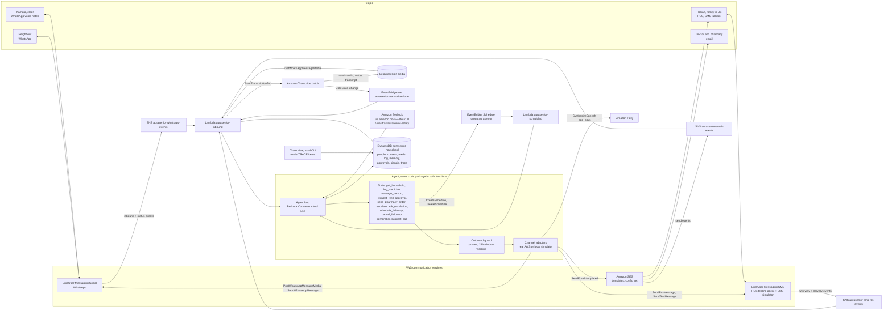

# Design

Status: Milestone 1 design, first full version (2026-10-10). Every AWS API, parameter, resource type, model ID and
limit named here is backed by an entry in `docs/decisions.md` (official doc URL or a real read-only call saved in
`docs/evidence/`). Anything not yet confirmed is listed as an open assumption in section 18 and in `decisions.md`
D13, and must be resolved before the code that depends on it is called done.

## 1. Overview

AuraSenior is a companion that lives inside WhatsApp for older people who send voice notes and will not install an
app. It checks in each morning, understands voice replies in Hindi and English, keeps family and care team informed
on RCS, SMS and email, and only acts on her behalf (refills, alerts) after a person approves.

It is not a medical device. It never diagnoses, names a disease, changes doses or gives a health score.

It is built for families split across countries, and the country logic is data, not code. Each person in a
household has `country`, `language`, `preferred_channel` and `fallback_channel`. The agent sends on the preferred
channel and uses the fallback when a send fails or, for urgent messages, is not delivered in time. There is no
country routing engine.

Demo household: Kamala (78, Pune, India, Hindi, WhatsApp voice), her son Rohan (Seattle, US, English, RCS with SMS
fallback), a neighbour (India, WhatsApp), and her doctor and pharmacy (email). The README also shows a config-only
US household (English-speaking elder in Ohio, daughter on RCS) that uses the same code.

Default channel per person type (a convention for household setup, not code):

| Person | preferred_channel | fallback_channel | Why |
| --- | --- | --- | --- |
| Elder (any country) | whatsapp | none | WhatsApp voice works in every country the demo needs |
| Family in the US | rcs | sms | RCS testing agent and SMS simulator are US based (D8) |
| Family outside the US | whatsapp | email | No SMS to India: it needs DLT registration (VISION.md lead times) |
| Neighbour | whatsapp | email (if given) | Same reason |
| Doctor, care coordinator, pharmacy | email | none | Short factual email is what they want |

## 2. Architecture

Serverless and event driven. Every inbound event reaches AuraSenior through an Amazon SNS topic, an EventBridge rule
or an EventBridge Scheduler schedule. There is no public HTTP endpoint in Milestone 1 (section 2.3).



### 2.1 Compute

Two Lambda functions share one Python package `src/aurasenior/` (runtime `python3.13`, listed as supported until
2029 on the Lambda runtimes page, D9). Architecture `arm64` for both (`Architectures: [arm64]` in the template, D9).
The package is pure Python plus boto3, so it has no native wheels that would tie it to x86_64:

- `aurasenior-inbound`: subscribed to the three SNS topics and the target of the Transcribe EventBridge rule. It
  parses the event, dedupes it, resolves the sender to a household and person, and runs one agent turn when a person
  said something. Status and delivery events only update DynamoDB and the trace (and trigger fallback, section 7.3).
  Timeout 120 s, memory 512 MB.
- `aurasenior-scheduled`: target of every schedule. Payload `{"kind", "household_id", ...}` with kind one of
  `checkin`, `followup`, `missed_checkin`, `escalation_recheck` (adds `escalation_id`, `run`), `delivery_check`,
  `approval_expiry` (adds `approval_id`), `weekly_summary`. Timeout 120 s, memory 512 MB.

The agent runs in-process in both functions. One code path, no extra network hop.

### 2.2 Region, account and naming

us-east-1, the project AWS account only (`AWS_PROFILE=the-unsent`). One CloudFormation stack `aurasenior`, every
resource name prefixed `aurasenior-`, every taggable resource tagged `project=aurasenior`. Nothing else in the
account is read or changed.

### 2.3 No public endpoint

WhatsApp, SMS and RCS inbound messages and all delivery events arrive through SNS topics (D5, D6, D7), SES events
through a configuration set SNS destination (D7), Transcribe completion through EventBridge (D10). The SMS fallback
for approvals uses reply digits instead of a short link, so no web page is needed. The trace view is a local CLI
(`python -m aurasenior.trace`) that reads DynamoDB with the developer's own credentials. With no public endpoint
there is nothing to authenticate or rate limit on the internet side; abuse control is the per-household model call
cap (section 8.4) and the SNS topic policies. Each topic policy allows only its own publisher to `sns:Publish`, with
an `aws:SourceAccount` condition set to the stack account:

| Topic | Publisher principal | Doc |
| --- | --- | --- |
| `aurasenior-whatsapp-events` | `social-messaging.amazonaws.com` | D5 |
| `aurasenior-sms-rcs-events` | `sms-voice.amazonaws.com` | D6 |
| `aurasenior-email-events` | `ses.amazonaws.com` | D7 |

## 3. AWS services and APIs used

All verified, see `docs/decisions.md` (entry in brackets).

| Service | Used for | APIs / resources |
| --- | --- | --- |
| End User Messaging Social | WhatsApp text, voice notes and templates with elder and neighbour | `SendWhatsAppMessage` (`originationPhoneNumberId`, `message`, `metaApiVersion`), `PostWhatsAppMessageMedia` (`sourceS3File`), `GetWhatsAppMessageMedia` (`destinationS3File`), `CreateWhatsAppMessageTemplate`, `ListWhatsAppMessageTemplates`, `PutWhatsAppBusinessAccountEventDestinations`, `GetLinkedWhatsAppBusinessAccount`. No CloudFormation type exists (D5) |
| End User Messaging SMS and RCS | RCS rich cards and text to family in the US, SMS fallback, STOP keywords | `SendRcsMessage` (`RcsMessageContent`, `FallbackConfiguration` with `Channel` `SMS`), `SendTextMessage`, `CreateVerifiedDestinationNumber` (test device), `UpdateRcsAgent`, `DescribeOptedOutNumbers`; `AWS::SMSVOICE::PhoneNumber` (type `SIMULATOR`), `AWS::SMSVOICE::OptOutList`, `AWS::SMSVOICE::ConfigurationSet` (D6) |
| Amazon SES | Pharmacy order, weekly summary, email fallback | SES v2 `SendEmail` with `Content.Template`, `ConfigurationSetName`, `ListManagementOptions`; `AWS::SES::Template`, `AWS::SES::ConfigurationSet`, `AWS::SES::ConfigurationSetEventDestination`, `AWS::SES::ContactList` (D7) |
| Amazon Bedrock | Agent reasoning and replies | `Converse` with `toolConfig`, `guardrailConfig`; inference profile `us.amazon.nova-2-lite-v1:0`; `AWS::Bedrock::Guardrail` (D1, D2, D11) |
| Amazon Transcribe | Voice note to text with word timings | `StartTranscriptionJob` (`MediaFormat` `ogg`, `LanguageCode` `hi-IN`/`en-IN`/`en-US`, `OutputBucketName`), `GetTranscriptionJob`; EventBridge `Transcribe Job State Change` (D10) |
| Amazon Polly | Text to WhatsApp voice note | `SynthesizeSpeech` (`OutputFormat` `ogg_opus`, `SampleRate` `48000`, `LanguageCode`), voices Kajal and Joanna (D3, D3b) |
| EventBridge Scheduler | Daily check-in, weekly summary, one-time follow-ups | `CreateSchedule` (`ScheduleExpression` `cron(...)` or `at(...)`, `ScheduleExpressionTimezone`, `FlexibleTimeWindow`, `ActionAfterCompletion` `DELETE`), `DeleteSchedule`; `AWS::Scheduler::ScheduleGroup` (D8) |
| Amazon EventBridge | Transcribe completion to Lambda | `AWS::Events::Rule` (D10) |
| AWS Lambda | All compute | `AWS::Lambda::Function` via `AWS::Serverless::Function` (D9, D12) |
| Amazon DynamoDB | All household state and trace | `AWS::DynamoDB::Table`, on-demand, TTL (D9) |
| Amazon S3 | Voice notes in and out, transcripts | `AWS::S3::Bucket` `aurasenior-media-<account>`, lifecycle expiry 30 days (D9) |
| Amazon SNS | Inbound and event fan-in | `AWS::SNS::Topic`, `AWS::SNS::TopicPolicy`, `AWS::SNS::Subscription` (D5, D6) |
| Amazon CloudWatch, AWS Budgets | Logs, alarm on errors, monthly budget | Lambda log groups (retention 14 days), `AWS::CloudWatch::Alarm`, budget `aurasenior-monthly` (D9) |

## 4. Agent runtime decision

Decision: Option B, the agent loop runs inside Lambda and calls the Bedrock Converse API with tool use. Memory, state
and the trace are kept in DynamoDB. Recorded as D11 in `docs/decisions.md`.

Option A was Bedrock AgentCore Runtime, Memory and Observability with a Strands agent. AgentCore is reachable in
this account and region (D4), and the `bedrock-agentcore` 1.24.1 and `strands-agents` 1.59.0 packages install in
the project venv. It is not chosen for Milestone 1 for these reasons:

1. Converse with tool use is already proven end to end in this account with the default model, including a Hindi
   reply (D2). AgentCore Runtime has not had a single successful deploy or invoke here yet.
2. Direct code deploy for AgentCore Runtime needs a zip of Linux arm64 dependencies uploaded to S3 and an
   entrypoint that follows the runtime service contract (D11 doc links). Every inbound message would then go
   Lambda to `InvokeAgentRuntime` to the agent, which adds a hop and a second deploy artifact while the event
   sources (SNS, EventBridge, Scheduler) still need Lambda anyway.
3. The demo trace view needs every tool call, every channel decision and the simulated flag in one place. Writing
   our own `TRACE` items gives exactly that, and it is easy to unit test. AgentCore Observability needs CloudWatch
   Transaction Search set up (D11), which was not checked against the `aurasenior-dev` policy.
4. The timeline needs core flows working on simulators by Oct 15.

The agent sits behind one interface, `AgentRunner.run_turn(household_id, person_id, event) -> TurnResult`, so a
later AgentCore implementation can replace the Lambda in-process runner without touching tools, adapters or data.
Moving to AgentCore is listed in `docs/roadmap.md` and is only considered after every must-have is done and
verified by 2026-10-20 (BUILD_BRIEF.md). It is not part of this design.

Model: `us.amazon.nova-2-lite-v1:0` from `[agent] model_id` in `config/app.toml` (D2). Hindi output quality is
reviewed by a person before the demo (open assumption A6).

## 5. IaC decision

Decision: AWS SAM. Recorded as D12 in `docs/decisions.md`.

Reasons:

1. The app is Python only. SAM needs no second language toolchain; the CDK would add a TypeScript or Python CDK app
   and the CDK CLI, neither installed today. SAM CLI 1.165.0 is installed.
2. Every resource the stack needs is a plain CloudFormation type that exists in this account and region, confirmed
   with `cloudformation describe-type` (evidence `cfn-types-2026-10-10.json`). No CDK construct is needed to reach
   them.
3. `sam deploy --stack-name aurasenior --tags project=aurasenior` gives one named stack. `--resolve-s3` uploads
   artifacts to the existing shared `aws-sam-cli-managed-default` bucket, which BUILD_BRIEF.md allows to be used but
   not modified. No new shared stack is created.
4. `sam local invoke` and `sam build` let the README deploy steps be short and reproducible.

What is not in the template, and why:

- WhatsApp: `AWS::SocialMessaging::WhatsAppBusinessAccount` does not exist (TypeNotFound, D5). The owner links the
  WhatsApp Business Account in the console; `scripts/post_deploy.py` then calls
  `PutWhatsAppBusinessAccountEventDestinations` to point it at `aurasenior-whatsapp-events`, and
  `CreateWhatsAppMessageTemplate` to submit the templates in section 6.2.
- RCS agent: `AWS::SMSVOICE::RcsAgent` exists as a resource type (D6), but the testing registration and the test
  device are done by the owner in the console, because adding a test device sends a verification code to the phone
  that a person must enter (D6). Keeping the agent out of the stack also means a stack update can never replace it
  and drop the registered test device. The RCS agent ID is a stack parameter; `post_deploy.py` calls
  `UpdateRcsAgent` to set the two-way SNS topic and the opt-out list.
- Per-household schedules: households are data, so `scripts/seed_household.py` creates their schedules. The stack
  only creates the schedule group `aurasenior` and the scheduler execution role.

In the template, beyond the functions, table, bucket, topics, rule and SES and SMS resources: budget
`aurasenior-monthly` as `AWS::Budgets::Budget` (monthly cost budget, email alert at 80 percent to the owner address
given as a stack parameter). The `aurasenior-dev` policy allows `budgets:ModifyBudget` and `budgets:ViewBudget` on
`aurasenior-*` (D9).

`post_deploy.py` is idempotent: it reads before it writes and only touches resources whose name starts with
`aurasenior`.

## 6. Channel matrix

### 6.1 Rules the matrix follows

- WhatsApp 24-hour customer service window: free-form messages (text, audio) are only allowed within 24 hours of
  the person's last message to us; outside it only an approved template may be sent (D5, Meta pricing and template
  guideline pages). AuraSenior stores `wa_last_inbound_at` per person and treats the window as open only if that
  time is less than 23 h 30 min ago (30 min safety margin for clock skew and long agent turns).
- RCS and SMS have no such window. Every RCS send carries `FallbackConfiguration` with `Channel` `SMS` and a short
  SMS body, so AWS falls back on its own when RCS cannot reach the phone (D6).
- Email is only used for doctor, pharmacy and family who prefer email, and as the fallback for family outside the US.
- Every send passes the outbound guard (section 8.3): consent on that channel, window rule, wording rule.

### 6.2 Matrix

Template and card names are the exact names used in code and in `scripts/post_deploy.py`. WhatsApp templates exist
in two languages each (`_hi`, `_en`); the language comes from the person's `language` row (section 9.2).

| Event | Kamala (elder, WhatsApp) | Rohan (family US, RCS then SMS) | Family outside US / neighbour (WhatsApp then email) | Doctor / pharmacy (email) |
| --- | --- | --- | --- | --- |
| Opt-in | WA template `aurasenior_optin`, body asks her to reply YES (or हाँ) to start and STOP to stop. Nothing else is sent until YES | RCS text "Reply YES to get updates about Kamala. Reply STOP to stop." SMS fallback same text | WA template `aurasenior_family_optin`; email fallback SES `aurasenior-optin` | SES `aurasenior-optin` to a verified address; consent recorded when they confirm to the household admin (section 14) |
| Daily check-in (9:00 her time) | Window closed (usual): WA template `aurasenior_checkin`. Window open: Polly voice note (audio) | none | none | none |
| Voice reply understood | Voice note reply within the open window (she just wrote, so it is open) | none unless an action follows | none | none |
| Follow-up (no reply 90 min after check-in) | WA template `aurasenior_followup` | none | none | none |
| Missed check-in (no reply 60 min after follow-up) | none | RCS text `missed_checkin`; SMS fallback "No reply from Kamala this morning. Reply 3 to get her number." | WA template `aurasenior_family_missed`; email fallback SES `aurasenior-missed-checkin` | none |
| Refill approval | none | RCS rich card `refill_approval`: title "Mom's BP tablets ran out", three Reply suggestions Order refill (`refill:approve:<id>`), I'll handle it (`refill:self:<id>`), Call Mom (`refill:call:<id>`). SMS fallback "Mom's amlodipine ran out. Reply 1 to order a refill, 2 if you will handle it, 3 for her number." | WA template `aurasenior_family_refill` with three quick-reply buttons (same meanings); email fallback SES `aurasenior-refill-request` that says to reply on WhatsApp or call her (no approve by email) | none |
| Pharmacy order (only after Order refill) | none | none | none | SES `aurasenior-refill-order` to the pharmacy |
| Refill confirmation | Window open: Polly voice note "Rohan has ordered your BP tablets." Window closed: WA template `aurasenior_refill_update` | RCS text "Order sent to <pharmacy>." | WA free-form if their window is open, else WA template `aurasenior_family_update`; email fallback SES `aurasenior-update` | none |
| Fall or help words | Voice notes every 5 min while the window is open, saying who has been told, until someone acknowledges | RCS text `urgent_alert` with Reply suggestion I'm on it (`esc:ack:<id>`); SMS fallback "URGENT: Kamala said she slipped. Reply 4 if you are on it." | WA template `aurasenior_urgent_alert` with quick reply I'm on it; email fallback SES `aurasenior-urgent` | none |
| Escalation recheck (no ack in 10 min) | continues voice notes | resend RCS `urgent_alert` | resend template; send email fallback even if WhatsApp was delivered | none |
| "How was Mom this week?" | none | RCS text reply built from the week's data (inbound RCS or SMS text starts it) | WA free-form reply (their message opened the window) | none |
| Worth a call suggestion | none | RCS text `worth_a_call` (section 15) | WA template `aurasenior_family_update`, or free-form if the window is open | none |
| Weekly summary (Sunday 18:00 her time) | none | SES `aurasenior-weekly-summary` if Rohan has an email address with consent | SES `aurasenior-weekly-summary` | SES `aurasenior-weekly-summary` to the doctor |
| STOP | Text STOP, बंद, band, or a voice note whose whole transcript is one of those words: WhatsApp consent set to opted_out at once, one WA free-form confirmation "You will not get more messages. Send START to begin again." | STOP on RCS or SMS: consent opted_out; the SMS opt-out list also records it (D6) | Same as Kamala for WhatsApp; email via SES unsubscribe (section 14) | SES unsubscribe link (section 14) |

Template category for all WhatsApp templates: UTILITY, because they are updates tied to the person's own service
(open assumption A3: Meta may re-categorise). All templates are submitted on the first day the WhatsApp Business
Account is linked, because Meta review can take up to 24 hours (D5).

## 7. Channel adapters and local simulators

### 7.1 Interface

`src/aurasenior/channels/base.py`:

```python
class ChannelAdapter(Protocol):
    channel: str                      # "whatsapp" | "rcs" | "sms" | "email"
    simulated: bool
    def send(self, msg: OutboundMessage) -> SendResult: ...
    def parse_inbound(self, raw: dict) -> InboundMessage | None: ...
    def parse_status(self, raw: dict) -> StatusEvent | None: ...
```

`OutboundMessage` carries `person_id`, `kind` (`text`, `voice`, `template`, `card`, `email_template`), the content,
`urgency` (`normal` or `urgent`) and `correlation_id`. `SendResult` is `sent(provider_message_id)` or
`failed(code, retryable)`.

Implementations, chosen per channel by `[channels] <name> = "aws" | "sim"` in `config/app.toml`:

- `WhatsAppAws`: voice notes are Polly `SynthesizeSpeech` (`ogg_opus`, 48000 Hz) written to
  `s3://aurasenior-media-<account>/out/<household>/<id>.ogg`, then `PostWhatsAppMessageMedia` with `sourceS3File`
  returns a media ID, then `SendWhatsAppMessage` with a Cloud API `audio` message using that ID. `metaApiVersion` is
  `v20.0`, as in the AWS examples (D5). Inbound audio is fetched with `GetWhatsAppMessageMedia`
  `destinationS3File` into `in/<household>/<id>.ogg`.
- `RcsAws`: `SendRcsMessage` with `RcsMessageContent` (a `RichCard.StandaloneCard`, `CardOrientation` `VERTICAL`,
  up to 4 card suggestions; or plain text), `FallbackConfiguration` `{Channel: "SMS", MessageBody,
  OriginationIdentity: <simulator number>}`, `ConfigurationSetName` `aurasenior-sms`, and `Context`
  `{correlation_id}` (max 5 entries) so delivery events can be matched (D6).
- `SmsAws`: `SendTextMessage` from the simulator origination number with `ConfigurationSetName` `aurasenior-sms`.
- `EmailAws`: SES v2 `SendEmail` with `Content.Template` (`TemplateName`, `TemplateData`),
  `ConfigurationSetName` `aurasenior-email`, and `ListManagementOptions` for summaries (D7).
- `*Sim`: append one JSON line per message to `.sim/<channel>.jsonl` and return `sent("sim-<uuid>")`. Inbound
  messages for tests are injected as the same raw payload shapes the real services publish to SNS (WhatsApp, two-way
  SMS/RCS, SES events), so `parse_inbound` and `parse_status` are tested on one code path.

Simulated sends are labelled: the adapter sets `simulated=True`, the trace item stores it, log lines carry
`"simulated": true`, and the trace view prints `[SIMULATED]` next to the message.

### 7.2 Demo reality per channel

- WhatsApp: real once the owner links the WhatsApp Business Account and the templates are approved; simulator until
  then.
- RCS: testing agent to Rohan's registered test device (real phone).
- SMS: the simulator origination number can only reach simulator destination numbers (D6). The RCS-to-SMS fallback
  and the SMS reply digits are shown with a second family record whose number is a simulator destination, plus the
  delivery events. Rohan's real phone never gets SMS in the demo.
- Email: SES sandbox, verified recipient addresses only, 200 per day, 1 per second (D7).

### 7.3 Fallback rule

1. Send on `preferred_channel`.
2. If the send call fails with a non-retryable error, or the consent or window check blocks it and no template can
   be used, send on `fallback_channel` at once.
3. If a status event later reports the message failed, send on `fallback_channel`.
4. For `urgent` messages only, a one-time `delivery_check` schedule fires 3 minutes later; if no delivered or read
   status was recorded, send on `fallback_channel`.
5. RCS to SMS needs none of this: AWS does it per message from `FallbackConfiguration` (D6). Our rule applies only
   when RCS and SMS both fail and the person has no other channel; then the trace records `undeliverable` and the
   next family member in the escalation list is tried for urgent messages.

`fallback_channel = none` means: record `undeliverable` in the trace and log at WARN.

## 8. Agent, tools and memory

### 8.1 Turn loop

`AgentRunner.run_turn` builds the system prompt (rules, the person, today's facts, memory notes), adds the last 10
turns, and calls `Converse` with `toolConfig` and `guardrailConfig` (guardrail `aurasenior-safety`, version from the
stack). It runs tools for each `toolUse` block, returns `toolResult` blocks, and repeats until `stopReason` is
`end_turn` or 6 iterations have run (then it stops and logs WARN). Max output tokens 800 per call. Pattern verified
in D2.

### 8.2 Tools seen by the model

The outline listed one tool per channel. That is changed: channel choice is data (preferred and fallback channel), so
the model asks to message a person and the router picks the channel. This removes a class of model errors, such as
a free-form WhatsApp message outside the window.

| Tool | Input (JSON schema, validated before running) | Effect |
| --- | --- | --- |
| `get_household` | none | People (names, roles, languages, channels, `relation_label`), medicines (`display_label`), today's log, open approvals and escalations |
| `get_week` | none | `WeekFacts` for the last 7 days as JSON (section 8.6). Used to answer "How was Mom this week?" |
| `log_medicine` | `medicine_id` (must exist), `taken` bool, `out_of_stock` bool | Writes `LOG#`, updates stock |
| `message_person` | `person_id` (must be in household), `text` 1 to 600 chars, `as_voice` bool (elder only), `urgency` | Routes per section 7.3; window closed and no template fits returns `blocked_window` to the model |
| `request_refill_approval` | `medicine_id`, `ask_person_id` (role family) | Creates `APPROVAL#` pending, sends the refill card or template |
| `escalate` | `reason` (`fall_or_help` or `missed_checkin`), `quote` up to 200 chars | Creates `ESC#`, alerts family and neighbour, schedules `escalation_recheck` |
| `ack_escalation` | `escalation_id` | Marks acknowledged, cancels recheck, tells the elder who is coming |
| `schedule_followup` | `kind` (`followup`, `missed_checkin`), `minutes` 5 to 240 | One-time `at()` schedule, `ActionAfterCompletion` `DELETE` |
| `cancel_followup` | `kind` | `DeleteSchedule`; not found is treated as done |
| `remember` | `note` 1 to 200 chars | Adds to memory notes (max 50, oldest dropped) |
| `suggest_call` | none (reads computed signals) | Sends the worth a call message from section 15 if one is due; the model cannot write its text |

Some steps never depend on the model: fall or help words found in a transcript (`slipped`, `fell`, `help`, गिर,
मदद, and the list in `config/keywords.toml`) call `escalate` directly before the agent turn, so an urgent alert
is never lost to a model error. STOP keywords are handled before the agent too.

The pharmacy order is also never a model decision. `send_pharmacy_order(approval_id)` is a plain function in
`src/aurasenior/refill.py`, not a model tool. It is called only by the inbound handler after a person's approval
(section 12). The model can only ask for approval.

### 8.3 Outbound guard (single choke point)

Every send goes through `outbound.guard(person, channel, message)`. It owns these invariants because it is the one
place every path crosses, including deterministic paths that skip the model:

1. Consent: the person is `opted_in` on that channel. Otherwise `blocked_consent`.
2. WhatsApp window: free-form only if the window is open (section 6.1); else a template must be named. Otherwise
   `blocked_window`.
3. Wording: blocks text that contains a disease name, a dose instruction, or the words score, diagnosis,
   diagnose (lists in `config/wording.toml`, one list per language row, Hindi in Devanagari and in Latin script,
   and English). Blocked text is replaced by the fixed phrase `guard_replacement` from `config/phrases.toml` in the
   recipient's language and logged at WARN with the rule hit. For the elder it is "I have told {family_name}. They
   will call you." (`{family_name}` is the `display_name` of the first person in the escalation order); for family
   it is "Please call {elder_name}."
4. Rate: max 30 outbound messages with `urgency = normal` per household per hour (`USAGE#<date>` counter per hour).
   Urgent messages are not counted against this cap and are never blocked by it. They still pass rules 1 to 3 and
   are bounded by the escalation's own limit (12 rechecks, section 13).

Fallback after a block (section 7.3) is bounded: a `blocked_consent` result triggers a fallback send only if the
person is `opted_in` on the fallback channel, and the fallback send passes this same guard. A `blocked_wording`
result never triggers a fallback; the replacement phrase is sent instead.

All fixed sentences (STOP confirmation, guard replacement, cost cap note, refill confirmations, help text, opt-in
reply, "please send a voice note", "I could not hear that") live in `config/phrases.toml`, one table per language
row, with `{family_name}`, `{elder_name}`, `{relation_label}` and `{display_label}` placeholders. A unit test fails
if a language row is missing any phrase key, or if any phrase fails the wording rule.

The Bedrock guardrail `aurasenior-safety` adds denied topics for medical diagnosis and medication dose advice on
model input and output text. It uses the Standard safeguard tier for denied topics, because the Classic tier
supports only English, French and Spanish for denied topics, while the Standard tier lists Hindi as "Optimized and
supported" (D11). The Standard tier uses cross-Region inference (D11). Tool call arguments are not evaluated by a
guardrail in Converse (D11), which is why the guard above is the main wording control. The Hindi and English lists
in `config/wording.toml` are required and tested whatever the guardrail does.

### 8.4 Cost cap

Per household per day: max 150 Converse calls (`USAGE#<date>` atomic counter). Beyond that the agent is skipped,
deterministic paths (STOP, escalation, logging, approval taps, weekly summary) still run, the elder gets the fixed
phrase `cost_cap` ("I will tell {family_name}.") as a voice note, and an ERROR log is written once per day.

### 8.5 Memory

Kept in DynamoDB per household: `MEMORY` item with up to 50 short notes (her routine, people she mentions,
grandchildren's names), turns as `TURN#<person_id>#<ts>` items with a 7-day TTL, and medicines and log from their
own items. A turn's prompt includes only the last 10 turns of the person who is speaking, so the elder's words never
reach a family member's prompt. Family see the elder's situation only through `get_household` and `get_week`, which
never include transcript text unless the elder's `share_transcripts` flag is true.

### 8.6 Weekly facts

`summary.build_week(household_id, end_date, days=7) -> WeekFacts` in `src/aurasenior/summary.py` is deterministic
(no model call) and unit tested. It reads `LOG#`, `APPROVAL#`, `ESC#`, `SIGNAL#` and `MSG#` items for the 7 days
ending on `end_date` in the household timezone and returns:

| Field | Content |
| --- | --- |
| `days` | 7 |
| `medicines` | per medicine: `display_label`, days taken, days not taken, days with no answer |
| `refills` | count requested, count ordered, and per order the time from "ran out" to "ordered" in minutes |
| `escalations` | per escalation: reason (`fall_or_help`, `missed_checkin`), time to acknowledgement in minutes or `unacknowledged` |
| `missed_checkins` | count |
| `mentions` | counts of pain and low-mood mentions (words only, no quotes) |
| `quotes` | elder transcript lines, only if `share_transcripts` is true, else empty |

The model tool `get_week` returns this as JSON. The weekly SES summary (section 10) is rendered from `WeekFacts`
straight into the SES template variables, with no model call.

## 9. Household data model

### 9.1 Table `aurasenior-household`

On-demand billing, partition key `PK` (S), sort key `SK` (S), TTL attribute `ttl`. No GSI.

| PK | SK | Content |
| --- | --- | --- |
| `HH#<hid>` | `PROFILE` | name, `timezone` (IANA, e.g. `Asia/Kolkata`), `checkin_time` `HH:MM`, elder person ID, `admin_person_id` (the family member who set up the household, Rohan in the demo), escalation order (person IDs), `share_transcripts` |
| `HH#<hid>` | `PERSON#<pid>` | `role` (elder, family, neighbour, doctor, pharmacy), `display_name`, `relation_label` (family and neighbour only: how this person names the elder, e.g. "Mom", "Maa", "Kamala ji"), `country` (ISO 3166-1 alpha-2), `language` (row key in section 9.2), `preferred_channel`, `fallback_channel`, `addresses` {whatsapp, rcs, sms: E.164; email}, `consent` {channel: {status, at, source}}, `wa_last_inbound_at` |
| `HH#<hid>` | `MED#<mid>` | `name` (as on the pack, used only in the pharmacy email), `display_label` (plain name the family uses, e.g. "BP tablets", used in every family and elder message), time of day, `stock` (`ok`, `low`, `out`, `ordered`), pharmacy person ID |
| `HH#<hid>` | `LOG#<yyyy-mm-dd>#<mid>` | taken, source message ID |
| `HH#<hid>` | `MEMORY` | notes list |
| `HH#<hid>` | `TURN#<pid>#<ts>` | role, text, `ttl` 7 days |
| `HH#<hid>` | `APPROVAL#<aid>` | kind, medicine, status (`pending`, `approved`, `self`, `declined`, `ordered`, `expired`), asked person, times |
| `HH#<hid>` | `ESC#<eid>` | reason, quote, status (`open`, `acknowledged`, `unacknowledged`), who acknowledged, `recheck_run` |
| `HH#<hid>` | `SIGNAL#<yyyy-mm-dd>#<msg>` | features from section 15, `simulated` (true only for a labelled seeded baseline) |
| `HH#<hid>` | `MSG#<provider_id>` | channel, person, status history, correlation ID, `transcribe_job` (inbound audio only) |
| `HH#<hid>` | `SEND#<correlation_id>` | `status` (`sending`, `sent`), provider ID; makes sends inside a retried event idempotent (section 11.1) |
| `HH#<hid>` | `TRACE#<ts>#<seq>` | step, tool, inputs (phone numbers and emails masked), outcome, channel, `simulated`, `ttl` 30 days |
| `HH#<hid>` | `USAGE#<yyyy-mm-dd>` | Converse call count, normal outbound count per hour |
| `ADDR#<channel>#<address>` | `ADDR` | household and person (reverse lookup for inbound) |
| `TJOB#<job name>` | `TJOB` | household, person, WhatsApp message ID (reverse lookup when the Transcribe event arrives), `ttl` 7 days |
| `DEDUP#<event id>` | `DEDUP` | `status` (`processing`, `done`), `at`, `ttl` 7 days (section 11.1) |

Stock lifecycle: `log_medicine(out_of_stock=true)` sets `out`; `send_pharmacy_order` sets `ordered`; the next
`log_medicine(taken=true)` for that medicine sets `ok`.

IDs: `APPROVAL#` and `ESC#` IDs are `secrets.token_hex(6)` (12 lowercase hex characters), so they match the
postback pattern in section 12.

### 9.2 Language table

One table in `config/app.toml` drives Transcribe, the reply language in the prompt, the Polly voice and the WhatsApp
template language. Adding a language is one row plus a verification test, no code change. Only Hindi and English
are built, tested and claimed.

| Key | Transcribe `LanguageCode` | Reply language in prompt | Polly voice, engine, `LanguageCode` | WhatsApp template suffix |
| --- | --- | --- | --- | --- |
| `hi-IN` | `hi-IN` | Hindi, Devanagari script | Kajal, neural, `hi-IN` | `_hi` |
| `en-IN` | `en-IN` | English | Kajal, neural, `en-IN` | `_en` |
| `en-US` | `en-US` | English | Joanna, neural, `en-US` | `_en` |

Transcribe supports all three codes for batch jobs (D10). Kajal is bilingual en-IN with hi-IN (D3). Joanna is listed
for en-US with the neural engine by a real `DescribeVoices` call (D3b). Spanish is roadmap only.

### 9.3 Validation of the household seed file

`scripts/seed_household.py households/<name>.toml` rejects the file (exit 1, message names the field) when: a
required field is missing (`role`, `display_name`, `country`, `language`, `preferred_channel`); `language` is not a
row in 9.2; a channel is not one of `whatsapp`, `rcs`, `sms`, `email`, `none`; the preferred or fallback channel has
no address; a phone number is not E.164 (`^\+[1-9]\d{6,14}$`); `sms` is set for a non-US number; `timezone` is not
a valid IANA name; there is not exactly one elder; `admin_person_id` is missing or not a family member;
`relation_label` is missing for a family member or neighbour (1 to 30 characters); `display_label` is missing for a
medicine (1 to 40 characters). Consent always starts as `pending`; the seed file cannot set it. Consent changes
come only from the person's own reply (WhatsApp, RCS, SMS) or, for email only, from the admin command in
section 14.

## 10. Scheduled check-in

`seed_household.py` creates, in group `aurasenior`:

- `aurasenior-checkin-<hid>`: `cron(MM HH * * ? *)` from `checkin_time`, `ScheduleExpressionTimezone` from the
  household timezone, `FlexibleTimeWindow` `OFF`, target `aurasenior-scheduled` with `{"kind":"checkin"}` (D8).
- `aurasenior-weekly-<hid>`: `cron(0 18 ? * SUN *)` in the household timezone, `{"kind":"weekly_summary"}`.

Check-in run: skip if the elder is not `opted_in` on WhatsApp. If the window is open, the agent composes a voice
note. If closed (the usual case at 9:00, because her last message was about 24 hours ago), send
`aurasenior_checkin_<lang>` (section 6.3) with her name as `{{1}}`. That template carries one quick-reply button,
"सुनें" in Hindi and "Listen" in English. Then `schedule_followup(followup, 90)`.

How the voice note reaches her when the window is closed: a tap on "सुनें" / "Listen" is an inbound WhatsApp
message, so it opens the 24-hour window (D5). The inbound handler recognises the button payload `listen:checkin`
(or `listen:followup`) and, with no agent turn, sends at once the Polly voice note for the fixed phrase
`checkin_voice` from `config/phrases.toml` in her language (for Hindi: "सुप्रभात। आप कैसी हैं? क्या आपने चाय के साथ
अपनी BP की गोली ले ली?"). Her voice reply then runs the normal agent turn. Header media types on templates: Meta's
template docs list the allowed header formats (D5); an audio header is not used, so this button rule is the
design. When she replies by voice or taps the button, the inbound path cancels the follow-up and missed check-in
schedules.

Weekly summary run (`{"kind":"weekly_summary"}`): `summary.build_week(household_id, today)` (section 8.6), then
one SES `SendEmail` per recipient with an email address and `consent.email = opted_in` (doctor, and family whose
`preferred_channel` or `fallback_channel` is email), template `aurasenior-weekly-summary`, `TemplateData` filled
from `WeekFacts` (section 6.3). No model call. A recipient without email consent is skipped and traced
`blocked_consent`.

## 11. Voice note in, voice note out

### 11.1 Dedupe and retries

SNS and EventBridge invoke Lambda asynchronously and Lambda retries a failed invocation (D9). Dedupe must let a
retry through when the first attempt failed with a recoverable error, and must stop a duplicate delivery:

```text
put DEDUP#<event id> {status: "processing", at: now, ttl: 7 days}
    condition: attribute_not_exists(PK) OR (status = "processing" AND at < now - 5 min)
condition fails      -> skip (duplicate, or another invocation is working on it); DEBUG log
on success           -> update status = "done"
on recoverable error -> delete DEDUP#<event id>, then re-raise so Lambda retries
on fatal error       -> update status = "done" (no retry), handle per section 16
```

The event ID is the WhatsApp message ID, the two-way SMS/RCS `inboundMessageId`, the SES `mail.messageId` plus
event type, or the EventBridge event `id` for Transcribe.

Sends inside a retried turn are idempotent. Each send has `correlation_id = <event id>#<step>` where `step` is a
counter of sends within that event (deterministic because the deterministic paths run first and in order). Before
sending, put `SEND#<correlation_id>` with `status = sending` (condition: not exists, or `sending` older than
5 min). If the item exists with `sent`, skip the send. After the provider returns an ID, update to `sent`.
Agent turns are not replayed token for token, so on a retry the model may word a reply differently; the
`SEND#` check still stops a second send at the same step.

### 11.2 Steps

1. SNS WhatsApp event with an audio message: dedupe (11.1), set `wa_last_inbound_at`, mark the message read (D5),
   fetch media to S3 with `GetWhatsAppMessageMedia`.
2. `StartTranscriptionJob`: job name `aurasenior-<hid>-<first 32 hex characters of sha256(WhatsApp message ID)>`,
   because the raw message ID is long and can contain characters such as `=` that the job name pattern does not
   allow (D10). The name is stored on `MSG#` as `transcribe_job` and as a `TJOB#` item for the reverse lookup.
   `MediaFormat` `ogg`, `LanguageCode` from the person's language row (single language per job, A11), output to the
   media bucket under `transcripts/`.
3. EventBridge rule `aurasenior-transcribe-done` invokes `aurasenior-inbound` (D10), pattern:

   ```json
   {
     "source": ["aws.transcribe"],
     "detail-type": ["Transcribe Job State Change"],
     "detail": {
       "TranscriptionJobStatus": ["COMPLETED", "FAILED"],
       "TranscriptionJobName": [{"prefix": "aurasenior-"}]
     }
   }
   ```

   Prefix matching is a documented event pattern operator (D10). The handler also ignores names without a `TJOB#`
   item, as a second layer.
4. Read the transcript JSON. STOP and urgent keyword checks run first, then signals (section 15), then the agent
   turn.
5. Agent replies with `message_person(as_voice=true)`; the adapter synthesises with the person's Polly row.

## 12. Refill approval flow

1. Agent hears "BP tablets are finished": `log_medicine(out_of_stock=true)`, then `request_refill_approval` for the
   first family member in the escalation order.
2. Rohan taps a suggestion (RCS) or a quick-reply button (WhatsApp). The postback data (D6) or button payload (A2)
   is validated with `^(refill:(approve|self|call)|esc:ack):[a-z0-9]{12}$`. For `refill:*` the handler checks the
   approval exists in the sender's household and the sender is its asked person; for `esc:ack` it checks the
   escalation exists in the sender's household and the sender is family or neighbour. Anything else is ignored and
   logged at INFO.
3. `approve`: conditional update `pending` to `approved` (condition fails: already handled, reply with the help
   text). Then the inbound handler calls `send_pharmacy_order(approval_id)` directly in code: conditional update
   `approved` to `ordered`, SES `aurasenior-refill-order` to the pharmacy (requires the pharmacy's
   `consent.email = opted_in`, section 14), `MED#.stock = ordered`, then the fixed confirmations
   `refill_ordered_elder` to Kamala and `refill_ordered_family` to Rohan (section 6.3). No model call is on this
   path. If the pharmacy email is blocked or fails, the approval stays `approved`, Rohan gets `refill_order_failed`
   ("The order email could not be sent. Please call the pharmacy.") and an ERROR is logged.
   `self`: status `self`, Kamala hears `refill_self_elder` ("{family_name} will sort out your {display_label}.").
   `call`: Rohan gets a text with her WhatsApp number.
4. SMS replies are single digits:

   | Reply | Meaning | Target |
   | --- | --- | --- |
   | `1` | Order refill | newest `pending` approval whose asked person is the sender |
   | `2` | I'll handle it | newest `pending` approval whose asked person is the sender |
   | `3` | Send me her number | none needed; allowed for family and neighbour |
   | `4` | I'm on it | newest `open` escalation in the sender's household |

   A digit with no target, or any other text that is not a question, gets the `sms_help` phrase. Free text that is
   not a digit or keyword goes to the agent turn (this is how "How was Mom this week?" arrives on SMS).
5. Approval not answered in 12 hours: an `approval_expiry` one-time schedule (created with the approval) sets status
   `expired`, Rohan gets one reminder, nothing is ordered.

## 13. Missed check-in, fall and help

- Missed check-in: the `followup` schedule sends `aurasenior_followup`; it schedules `missed_checkin` for 60 minutes
  later, which runs `escalate(missed_checkin)` to the escalation order list.
- Fall or help: keyword match (section 8.2) or the model calling `escalate(fall_or_help)`. Family and neighbour are
  alerted at once as urgent, and the elder gets the `esc_told_elder` voice note at once ("I have told
  {family_name}. Someone will call you soon. Stay where you are, I am here.").
- Recheck: `escalate` creates a one-time `escalation_recheck` schedule 5 minutes later with `run = 1`; each run
  that finds the escalation still `open` creates the next one 5 minutes later, up to `run = 12` (60 minutes).
  Each run sends the elder the `esc_reassure_elder` voice note if her window is open. Even-numbered runs (every 10
  minutes) also resend the family alerts (RCS `urgent_alert` or WhatsApp `aurasenior_urgent_alert`) and the email
  fallback to family who have email consent. After run 12 the escalation status becomes `unacknowledged`, the trace
  records it and an ERROR is logged (which fires the `aurasenior-errors` alarm).
- Acknowledge: RCS `esc:ack:<id>`, WhatsApp button `esc:ack:<id>`, or SMS `4`. `ack_escalation` sets
  `acknowledged`, deletes the pending recheck schedule (not found is fine), and the elder hears `esc_ack_elder`
  ("{name} is on the way to help you." with the acknowledger's `display_name`).
- These are all `urgency = urgent`, so the hourly cap does not apply (section 8.3 rule 4). AuraSenior does not call
  emergency services; the family decides.

## 14. Opt-in and STOP

- WhatsApp opt-in is started by the person, never by AuraSenior. Meta requires businesses to get opt-in before
  messaging people on WhatsApp, and to state the business name the person is opting in to (D5). AuraSenior sends no
  template to anyone who has not written first.
  1. The household admin helps the elder (and the neighbour) send the word START to the AuraSenior WhatsApp number,
     using a `https://wa.me/<number>?text=START` link or QR code that prefills the text (open assumption A12 for the
     link format), or by typing START.
  2. That inbound message opens the 24-hour window. AuraSenior replies free-form, in the person's language, with a
     voice note plus short text from phrase `optin_ask`: "This is AuraSenior. {family_name} set this up for you.
     Each morning I will check in, and I will tell your family if you need help. Reply YES to start, or STOP to
     stop."
  3. YES, हाँ, haan, ha (text, or a voice note whose whole normalised transcript is one of these) sets
     `consent.whatsapp = {status: opted_in, at, source: "wa_inbound_yes"}`. Nothing else is sent until then.
  4. A message from an unknown number gets nothing (section 16). A known person who has not said YES gets only the
     `optin_ask` reply, at most once per day.
- WhatsApp STOP: STOP, बंद, band (text or whole-transcript voice note) sets `opted_out` at once and sends one
  free-form `stop_confirm` phrase inside the window ("You will not get more messages. Send START to begin again.").
  START then runs the opt-in steps again.
- RCS and SMS: the SMS phone number and RCS agent use opt-out list `aurasenior-optout` with the required keywords
  (STOP and the others listed on the keywords page, D6). The inbound handler also sets `opted_out` in the household
  record when the two-way payload keyword is an opt-out keyword. Before every SMS or RCS send the guard checks the
  household record; the opt-out list is the second layer.
- Email: summaries and updates are sent with `ListManagementOptions` (contact list `aurasenior-contacts`, topic
  `updates`), so SES adds an unsubscribe link and suppresses unsubscribed addresses (open assumption A8). The
  pharmacy order is transactional and only goes to a pharmacy the household set up.
- Email consent: there is no public endpoint, so email recipients (doctor, pharmacy, family with an email channel)
  cannot confirm by link. The household admin (`PROFILE.admin_person_id`) asks them, for example by phone, and then
  runs a local command with their own AWS credentials:

  ```text
  python -m aurasenior.admin consent <household_id> <person_id> email opted_in --source "phone call 2026-10-12"
  ```

  It writes `consent.email = {status, at, source: "admin:<text>"}` and a `TRACE#` item. `opted_out` works the same
  way. Only the `email` channel can be set like this; the command exits 1 for any other channel, because WhatsApp,
  RCS and SMS consent come only from the person's own reply. `--source` is required, 1 to 200 characters. The
  pharmacy order requires `consent.email = opted_in` on the pharmacy person.
- RCS and SMS opt-in for family: same pattern as WhatsApp. The family member sends START from their own phone to
  the RCS agent (or, for a simulator record, to the SMS number); AuraSenior replies with `optin_ask` and YES sets
  `consent.rcs` and `consent.sms` to `opted_in` with `source: "rcs_inbound_yes"` or `"sms_inbound_yes"`. Until YES,
  nothing else is sent to that person.
- Consent changes are written to the trace with time and source.

## 15. Tier 1 voice signals: change from her usual

Inputs per voice note, from the Transcribe JSON word items and our own message times:

- speech rate: words per minute between the first word start and the last word end;
- pauses: count of gaps over 1.0 s between words, and mean gap;
- reply delay: seconds from our last message to her voice note;
- amount spoken: word count and speaking time;
- mentions: pain and low-mood words from `config/keywords.toml` (Hindi and English).

Baseline: her own last 14 days, median and median absolute deviation (MAD) per feature, at least 5 voice notes
(else no signal). Scaled deviation for a note is `|x - median| / max(1.4826 * MAD, floor)`. `floor` is per feature
in `config/signals.toml` so that a MAD of 0 (for example identical reply delays) never divides by zero: 5 percent
of the median, with a minimum of 0.1 s for pause and delay features and 1 word for word counts. A feature is changed
when its scaled deviation is over 2.5 on 3 of her last 5 notes. Mentions count as changed at 3 or more in 7 days
when her 14-day baseline is below 1 per week.

Demo history: the demo needs at least 5 notes in 14 days. The plan is real notes: from 2026-10-12 the demo voice
sends one voice note a day to the real WhatsApp number (about 14 by 2026-10-26). Backup, used only if real
WhatsApp is not live in time: `scripts/seed_household.py --simulated-baseline` writes baseline `SIGNAL#` items
with `simulated = true`. The trace view prints `[SIMULATED BASELINE]` next to any signal computed from them, and
the README and the demo video say so. Simulated items are never mixed silently with real ones: a signal computed
from any simulated item is labelled.

Output, the only one allowed: at most one worth a call message per household per day to the first family member,
built from fixed phrases, for example "Worth a call today: {relation_label} has been speaking more slowly than her
usual this week and mentioned knee pain twice." Phrases live in `config/signals.toml`, one table per language row,
and are checked by a unit test that fails if any phrase contains a disease name, a number presented as a score, or
the words diagnosis, risk or score (and their Hindi equivalents in `config/wording.toml`). The output is only ever
a suggestion that a call may be worth it; it never states a cause, a condition or a level.
Signals are never shown to the elder, never called health data in the product, and the weekly summary only repeats
the plain mentions.

## 16. Error handling

| Operation | Failure | Kind | What happens | Log |
| --- | --- | --- | --- | --- |
| SNS event parse | Bad JSON, unknown shape | Fatal for that event | Dropped, Lambda returns success so SNS does not retry | WARN with event type only |
| Sender lookup | No `ADDR#` item | Fatal for that event | Dropped, no reply (unknown numbers get nothing) | INFO, number masked |
| Dedupe put | Condition fails (`done`, or `processing` under 5 min old) | Expected | Event skipped | DEBUG |
| Any step after the dedupe put | Recoverable error | Recoverable | `DEDUP#` deleted, exception re-raised so Lambda async retry runs (2 retries); `SEND#` items stop repeat sends | WARN |
| `GetWhatsAppMessageMedia` | Throttling or 5xx | Recoverable | As above | WARN |
| Media too large or unsupported type | Over 16 MB or not audio/text | Fatal for that message | Elder gets "Please send a voice note" | INFO |
| `StartTranscriptionJob` / job `FAILED` | Any | Fatal for that note | Elder gets "I could not hear that, please send it again"; no signal stored | ERROR |
| `Converse` | Throttling | Recoverable | 3 retries with backoff (SDK standard mode) | WARN |
| `Converse` | Access denied, validation, model gone | Fatal | Fixed phrase `cost_cap` ("I will tell {family_name}.") as a voice note; deterministic paths still run | ERROR |
| Tool input invalid | Schema check fails | Recoverable by model | `toolResult` with `status: error` and the reason, model may retry within 6 iterations | INFO |
| `SendWhatsAppMessage` | Window closed or template not approved | Fatal for that message | Fallback channel per 7.3; template status re-read once per day | WARN |
| `SendWhatsAppMessage` / `SendRcsMessage` / `SendTextMessage` / SES `SendEmail` | Throttling, 5xx | Recoverable | 2 retries, then fallback channel | WARN |
| Same | Validation, access denied, opted out, spend limit | Fatal | Fallback channel; trace `failed` with code | ERROR |
| `send_pharmacy_order` | Approval not `approved` (conditional update fails) | Fatal by design | Nothing sent; the tapper gets `sms_help` or the RCS help text | WARN |
| `send_pharmacy_order` | Pharmacy email consent missing, or SES send fails after retries | Fatal for that order | Approval stays `approved`; approver gets `refill_order_failed` | ERROR |
| Postback or digit | Pattern fails, wrong household or wrong person | Fatal for that event | Ignored | INFO |
| Admin consent command | Channel not `email`, unknown household or person, `--source` missing | Fatal | Exit 1 with the reason; nothing written | stderr only |
| `scheduler:CreateSchedule` for a recheck | Throttling or 5xx | Recoverable | Re-raise (the escalation alert was already sent and is protected by `SEND#`) | WARN |
| `CreateSchedule` | Conflict (same name) | Expected | Treated as already scheduled | DEBUG |
| `DeleteSchedule` | Not found | Expected | Treated as done | DEBUG |
| Cost cap reached | Counter over limit | Expected | Section 8.4 | ERROR once per day |
| Escalation never acknowledged | 12 rechecks (60 min) | Fatal for automation | Status and trace `unacknowledged` | ERROR, and the CloudWatch alarm on ERROR count fires |

Every handler catches what it can name; anything else propagates so Lambda retries and the CloudWatch alarm
`aurasenior-errors` (Errors metric over 0 in 5 minutes) fires. Logs are JSON lines with household ID and correlation
ID; phone numbers and emails are masked, transcripts are never logged.

## 17. Testing plan

Unit tests (pytest, no AWS): language table lookups; channel routing and fallback for every row of the matrix in
section 6.2; outbound guard (consent, window boundary at 23 h 29 min and 23 h 31 min, wording blocklist); STOP and
START keywords in Hindi and English; postback and SMS digit parsing (the four digits, no target, regex rejects
`esc:approve` and `refill:ack`); approval state machine including double taps (only one order) and the pharmacy
order running with a stub that would fail if any Converse call is made; seed file validation; signals on synthetic
Transcribe JSON (baseline under 5 notes gives nothing, 3 of 5 rule, MAD of 0 uses the floor, at most one message per
day, simulated baseline is labelled); `config/signals.toml` wording test; parse functions on the payload examples
from the AWS docs.

Tests added for the review findings:

- Retry: the first attempt raises a throttling error after the dedupe put, the second attempt processes the event
  and the stub adapter records exactly one send.
- Duplicate: the same event delivered twice after success produces one send.
- Transcribe job name: a `wamid` containing `=` and over 200 characters gives a name that matches the documented
  pattern and length (D10).
- Rate cap: one hour of an open escalation sends every urgent message while normal messages stop at 30.
- Recheck: 12 runs, elder note on each run with an open window, family resend on even runs, `unacknowledged` after
  run 12, nothing after an ack.
- Opt-in: no template is ever sent to a person whose WhatsApp consent is not `opted_in`; START then YES opts in.
- Admin consent: `email` works, `whatsapp` exits 1.
- `build_week` on a fixed set of items gives the expected `WeekFacts`; with `share_transcripts = false` no quote
  appears; a family member's prompt never contains `TURN#<elder>#` text.
- Render and guard: every template in section 6.3 and every phrase in `config/phrases.toml` is rendered with the
  demo household in each language row and passes the wording rule; every `{{n}}` has a value.
- Fallback after a block: a `blocked_consent` with no fallback consent sends nothing.

Agent tests: the agent loop with a stub Converse client that returns recorded `toolUse` responses (shape from the
D2 evidence), so tool order and validation are tested without model calls. One opt-in live test (`-m live`) runs
the D2 transcript through the real model.

End-to-end on simulators: `python -m aurasenior.demo` replays the demo story (START and YES opt-in, check-in
template, Listen tap and voice note, voice reply,
log, refill card, Order refill tap, pharmacy email, confirmation voice note, missed check-in, fall alert and ack,
"How was Mom?", weekly summary, STOP) with all adapters on `sim` and fake Transcribe output, then prints the trace.

Live checks, one at a time as each channel becomes available, saved to `docs/evidence/`: Polly voice note played in
WhatsApp, template send, inbound voice note to transcript, RCS card tap postback, RCS to SMS fallback events, SES
templated send and events.

## 18. Open assumptions to resolve

Each also appears in `docs/decisions.md` D13 with how it will be checked.

- A1. A Polly `ogg_opus` file sent as a WhatsApp `audio` message plays as a voice note.
- A2. Exact SNS payload shape for WhatsApp inbound audio, template quick-reply button taps, and status events.
- A3. Meta accepts the templates as UTILITY in Hindi and English, and the template language codes.
- A4. Transcribe batch output for Hindi Ogg Opus voice notes includes word start and end times.
- A5. RCS two-way payload field that carries `PostbackData` and the opt-out keyword.
- A6. Hindi reply quality of `us.amazon.nova-2-lite-v1:0` is good enough for Kamala (a Hindi speaker reviews 10
  replies).
- A7. SMS and RCS monthly spend limits are 1 USD each in this account (read in an earlier probe that ran under the
  wrong account, so re-read here); whether simulator messages count against them.
- A8. SES `ListManagementOptions` adds an unsubscribe link in the sandbox.
- A9. CloudFormation can create `AWS::Budgets::Budget` `aurasenior-monthly` with the deploy user's permissions
  (`budgets:ModifyBudget` on `aurasenior-*`).
- A10. EventBridge rule permissions (`events:PutRule` and related) are available to the deploy user (D14).
- A11. Kamala mixes Hindi and some English. Jobs use one language (`hi-IN`); accuracy on mixed speech is checked on
  the first real transcription. No language identification feature is added.
- A12. The `wa.me` link with `?text=START` prefills the message on the elder's phone. If it does not, the admin types
  START; the design does not depend on the link.
- A13. Exact WhatsApp template button payload in the inbound SNS event (part of A2) and that Meta accepts the
  template bodies in section 6.3 as written.
- A14. The Bedrock guardrail with the Standard tier is accepted by `AWS::Bedrock::Guardrail` with the property shown
  in D11, and works with the `us.amazon.nova-2-lite-v1:0` profile in Converse. Checked on first deploy and the first
  guarded call.
